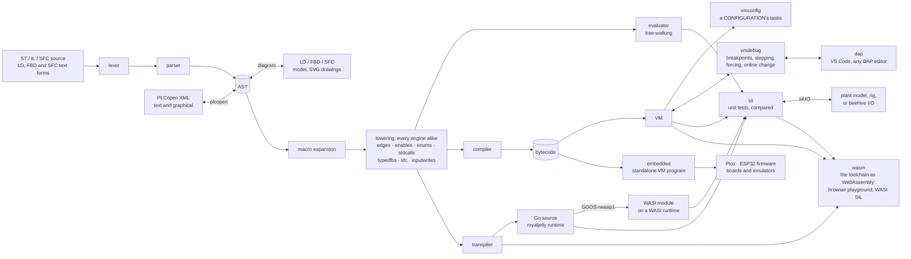

# Architecture

## The pipeline

1. The **lexer** turns source into tokens. It does not reserve IL operators
   or standard block names as keywords; the parser decides from context.
2. The **parser** builds one AST for all three languages, configurations
   and PLCopen imports. It records errors and resynchronizes at the next
   statement, so one mistake does not hide the rest.
3. **Macros** are expanded on the AST before any backend runs.
4. **Lowerings** rewrite the parts of the language that mean the same on
   every engine into plainer AST, so each backend gets them right alike:
   edge inputs, EN/ENO, bare enumeration values, formal calls of standard
   functions, the typed standard blocks, and (for the compiler and the
   transpiler) SFC to ST. Each backend applies them to the tree it is given.
5. A **backend** runs or compiles the AST: see [Backends](backends.md).
6. **Tests** (`PROGRAM TEST_...`) run on any of the backends through `sil`,
   scan by scan, and the engines are compared: see
   [Testing in the loop](#testing-in-the-loop).
7. **`wasm`** puts the pipeline itself behind one JSON call and builds it as
   a WebAssembly module, so it runs in a browser or a WASI runtime with no
   Go toolchain: see [wasm](../wasm/README.md).

## Packages

| Package | Role |
|---|---|
| `token` | Token types and keywords |
| `lexer` | Source to tokens: nested comments, typed literals (`T#1s`, `16#FF`, `DT#...`) |
| `parser` | Pratt (top-down operator precedence) parser for ST, IL, SFC, POUs, types, configurations; tracing with `-trace` |
| `ast` | The syntax tree, printing back to source, walking and modifying it, namespaces |
| `object` | Runtime values shared by the evaluator and the VM: integers, reals, strings, times, arrays, structures (hashes), function-block instances, built-ins |
| `stdlib` | Stateless built-in functions (conversions, arithmetic, strings, arrays, bit strings, selection, clock) registered with `object` at start-up |
| `edges` | `R_EDGE` and `F_EDGE` inputs of function blocks, lowered to an `R_TRIG`/`F_TRIG` around the body |
| `enables` | `EN` and `ENO` a POU declares itself, lowered to the IEC rules: the body runs only when `EN` is TRUE (IEC-75) |
| `enums` | An enumeration's value named without its type (`RED` for `COLOR#RED`) where exactly one enumeration has it |
| `stdcalls` | Formal calls of standard functions (`LIMIT(MN := 0, IN := v, MX := 20)`) rewritten to their inputs in order |
| `typedfbs` | The typed standard function blocks of Ed.3 (`CTU_INT` ... `CTUD_ULINT`, `TON_LTIME`, `TOF_LTIME`, `TP_LTIME`) in ST, given to a program that uses one without declaring it |
| `sfc` | Sequential Function Charts lowered to ST, so a chart runs on the compiler and VM, and in transpiled Go |
| `inputwrites` | The check that no POU assigns its own `VAR_INPUT` (IEC-69), for the evaluator and the transpiler; `AllowInputWrites` lifts it for CODESYS-style libraries |
| `analyzer` | Static analysis on the parser's AST, with types of its own worked out from the declarations: unused variables, unreachable code, implicit narrowing, multiple writes to an output, loops that do not end or may overrun the cycle time, and the PLCopen coding guidelines (`beedance -lint`; see [Static analysis](analyzer.md)) |
| `evaluator` | Tree-walking interpreter; standard function blocks; tasks and configurations; engineering sessions |
| `code` | Bytecode opcodes and their encoding |
| `compiler` | AST to bytecode: symbol tables, initialization and cyclic bytecode, program variables (with their `VAR_EXTERNAL`s, for a host to bind to its globals) |
| `vm` | The stack virtual machine that runs bytecode |
| `dap` | The Debug Adapter Protocol over `vmdebug`, for VS Code and other editors (`beedance -dap`): launch, breakpoints, stepping (by instruction in the disassembly view), the call stack, variables (writable), hover and watch expressions, and the PLC's own operations as custom requests and debug console commands: force, step a scan, online change, live values; for a simulator, the I/O image, inputs a scan at a time, scan events, the speed and a trace. See [Debugging](debugging.md) |
| `vmconfig` | A `CONFIGURATION` on the VM: its resources, their tasks (`INTERVAL`, `SINGLE`, priorities) and the program instances they run, with `VAR_CONFIG` |
| `vmdebug` | A debugger for a PROGRAM on any engine (the VM, the evaluator, or the program transpiled to Go, built and run in a process of its own, spoken to on its pipes), scan by scan on a simulated clock: breakpoints (with ST conditions) on source lines, stepping by statement (over, into, out) and by scan, pausing, the program's variables and each call's locals, writing and forcing variables and the I/O image, and online change between scans with the variables carried over by name and declared type; plant models (`PROGRAM PLANT_...`) run after each scan on the same clock and I/O image, a speed against the wall clock, and a trace of signals every scan. The session keeps the scan loop and an engine runs a scan with its hook in it: the VM's (`vm.SetHook`, `vm.ErrPaused`, on the compiler's line table), the evaluator's (`evaluator.Debug`) or the transpiled program's (`transpiler.Options.Debug`) |
| `transpiler` | AST to Go source for royaljelly; OSCAT functions from beebread; host binding; with `Options.Debug`, the debugger's hooks and variable tables in the file, for `vmdebug`'s go engine |
| `plcopen` | PLCopen TC6 XML import, export and validation; LD, FBD and SFC bodies kept graphical both ways |
| `diagram` | The model of the graphical languages: LD and FBD lowered to ST, their text form, PLCopen graphical XML both ways, and SVG drawings of LD, FBD and SFC bodies for previews |
| `native` | Function blocks implemented in Go, given to a program by its host (for example the TCP/IP blocks OSCAT NETWORK needs) |
| `ide` | The language half of an editor: go to definition, references, hover, completion, rename and the outline over one analysis of a source (`ide.Analyze`); LD, FBD and SFC bodies as models whose elements carry their text spans (`Diagrams`); gestures on them as minimal text edits, re-read and refused if they would add an error (`Apply`); a diagram live from any engine (`Values`: evaluator, VM, a rig, a controller as JSON), its wires worked out (`Diagram.Live`). beehive-lsp speaks LSP over it |
| `watch` | What a host can watch of a running program, on either engine, under dotted names (`p.tSample.ET`) |
| `sil` | Unit tests (`PROGRAM TEST_...`) on the evaluator, the VM and the transpiled Go, natively (`go`) or as a WASI module (`wasm`), compared scan by scan; I/O from a plant model, a rig over the rig protocol (TCP or serial), or a host such as beehive (`sil.IO`) |
| `embedded` | Generates a standalone Go program that embeds the VM and bytecode |
| `embedded/example/raspberrypi` | The VM with embedded bytecode as TinyGo firmware, for a Pico, a Pico W or an ESP32 |
| `embedded/esp32hw/plc` | `program.st` run as a PLC on the VM, scans 10 ms apart, reporting its outputs on the UART; `plc/gen` compiles it into `plc/program` (`go generate`) |
| `embedded/esp32hw` | Tests of firmware on a real ESP32 on a serial port, reset through RTS (build tag `esp32hw`, `ESP32_PORT`) |
| `embedded/esp32sim` | Tests of firmware on an emulated ESP32, ESP32-C3, ESP32-S3 or ESP32-C6 in Docker, Espressif's QEMU (build tag `esp32sim`) |
| `embedded/rig/pico` | A hardware-in-the-loop rig on a Raspberry Pi Pico, built with TinyGo: the rig protocol on its serial port, 8 digital inputs, 8 outputs, 3 analog inputs |
| `embedded/picosim` | Tests of Pico firmware, the rig among it, on an emulated RP2040 in Docker (build tag `picosim`) |
| `embedded/bench` | A module of its own: the three engines measured on microcontrollers, speed on a board or the emulator, size per engine, a sampling profile (it needs royaljelly for the transpiled engine) |
| `wasm` | The toolchain behind one JSON call, for a WebAssembly host: check, transpile, run the `TEST_` programs on the evaluator and the VM (`sil`), and sessions that run a PROGRAM on the VM scan by scan on a simulated clock, inputs set by name or address; and the debugger (`dap`) by whole messages, for a web page. Projects as PLCopen XML (`exportXML`, `importXML`, on `plcopen`). See [Web debugger](web-debugger.md) |
| `wasm/cmd/beedance-wasm` | `wasm` as a module: `GOOS=js` gives a page `beedance.handle` (the playground in `wasm/web`); `GOOS=wasip1` answers JSON lines on stdin and runs `test` with CI exit codes. `wasm/Dockerfile` runs it under Node.js (SIL) and serves the playground; its tests check the native, WASI and web builds agree (build tag `wasmsil`) |
| `connectors/honeycomb` | A module of its own: program variables to and from honeycomb tags, by address |
| `oscatdiff` | A module of its own: beebread's Go ports of OSCAT checked against the evaluator running the OSCAT sources, function by function and block by block, scan by scan |
| `repl` | The interactive read-eval-print loop |
| `main` (root) | The `beedance` command |

The compiler and VM do not import the evaluator, so a host that only runs
bytecode does not carry the interpreter. `vmconfig` does, to work out a
task's constant settings, and `vmdebug`, to evaluate breakpoint conditions;
a host that needs neither uses the compiler and the VM directly.

`examples/` holds sample programs and their tests; [Development](development.md#layout)
lists them. A test in the module root checks that every package directory
has a row here and that each top-level package appears in
[architecture.svg](architecture.svg).

## The object model

The evaluator and the VM share `object` values:

- elementary values are boxed (`*object.Integer`-style types per IEC type
  family, `*object.LReal`, `*object.String`, `*object.Time`, ...);
- a STRUCT or a function-block instance is an `*object.Hash` keyed by member
  name;
- an ARRAY is an `*object.Array` with its lower bound;
- built-in functions are `*object.Builtin`, found by index.

Boxing keeps the two engines simple and identical in behaviour; it is
also why the VM is slower than the transpiled Go (see
[Backends](backends.md#choosing-a-backend)).

## Scans

A PLC program runs as an initialization followed by a scan repeated by a
task. The compiler mirrors this: `CompileProgram` and `CompileProgramUnit`
return **initialization bytecode** (declarations, initial values, function
block definitions) and **cyclic bytecode** (the program body). A host runs
the first once and the second every scan, on the same globals. See
[Embedding](embedding.md).

## Design choices

- **One parser, three backends.** Every backend sees the same AST, so a
  program behaves the same whichever runs it; tests run the same programs
  on the evaluator, the VM and the transpiled Go.
- **Standards first.** Context-aware parsing keeps IEC identifiers free
  (a variable may be called `LD` or `R`).
- **No runtime dependencies.** The core uses only the standard library, so
  it builds for microcontrollers with TinyGo as far as each package allows,
  and, whole, for WebAssembly (`js/wasm` and `wasip1/wasm`).
- **The host owns time.** The evaluator and the VM read time through
  built-ins a host can replace, so timers follow the host's task clock.

## Testing in the loop

The same `PROGRAM TEST_...` unit tests run three ways (details in
[Hardware in the loop](hil.md) and [Command line](cli.md#unit-tests)):

| | The plant is | The clock is | Engines compared |
|---|---|---|---|
| Software in the loop | absent | simulated | yes, scan by scan |
| With a plant model | a `sil.IO` in Go | simulated, or the wall clock | with `Deterministic` |
| Hardware in the loop | a rig (TCP or serial), or beehive's I/O | the wall clock | no: each engine is judged on its own run |

- The **evaluator** is the simulator and debugger; the **VM** and the
  **transpiled Go** are what run on a target. `sil` runs a test on each
  engine it is given (`-engines eval,vm,go,wasm`) and, without real I/O, fails it
  when they disagree on any watched value after any scan.
- **I/O** is `sil.IO` (`Begin`, `Read`, `Write`, `End`): the test's located
  variables are the points. `%I` inputs are read before each scan, `%Q`
  outputs written after it. The **rig protocol** (JSON lines) carries it to
  a rig in any language; `sil.ServeRig` serves one in Go, and
  `embedded/rig/pico` is a ready-made rig on a Pico, which CI also runs on
  the emulated Pico (`embedded/picosim`).
- **beehive** runs the same tests on an edge node's tags
  (`LogicService.Test`), with `sil` and its own `sil.IO`.
- **WebAssembly** runs them with no Go toolchain, on the evaluator and the
  VM: `beedance-wasm test` under a WASI runtime (the `beedance-wasm` Docker
  image, for CI) or the playground in a browser. The `go` engine needs the
  toolchain, so it is not offered there.
