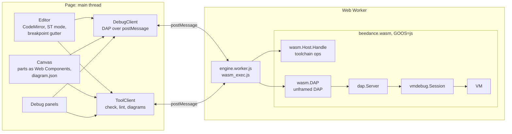

# The web debugger and simulator (plan)

Status: **planning**, with phase 0 built. This page is the design of a
browser IDE in the style of Wokwi, Velxio or Tinkercad Circuits, for IEC
61131-3: write a program, wire it to virtual field devices, and run and
debug it on the beedance VM compiled to WebAssembly, with nothing
installed. It is kept up to date as the phases land; what is built is
marked so.

## What it is

One page, three areas, as the circuit simulators lay them out:

```text
┌──────────────────────────────┬──────────────────────────────────────┐
│ ▶ ❚❚ ⤼ ⤵ ⤴ ⟳scan ■   speed ▾  │  scan 1 204 · 12.04 s · 10 ms/scan   │
├──────────────────────────────┼──────────────────────────────────────┤
│ main.st  plant.st  diagram   │   ┌──────── virtual PLC ────────┐    │
│  12 ● n := n + 1;            │   │ %IX0 ▢▣▢▢▢▢▢▢  %QX0 ▣▢▢▢▢▢▢▢ │    │
│  13 ▸ c(step := 2);          │   └──┬──────────────────┬───────┘    │
│  14   y := x;   (y = TRUE)   │    (start)            (lamp) ◉        │
│                              │    [push button]      [pilot light]   │
├──────────────────────────────┴──────────────────────────────────────┤
│ Variables · Watch · Call stack · Breakpoints · Forces · Console ·    │
│ Disassembly · Trace (signals over scans)                              │
└──────────────────────────────────────────────────────────────────────┘
```

- **Editor**: the source, with breakpoints in the gutter (conditions on
  right-click), the statement the program is stopped on, values inline
  while stopped, and parse and lint errors.
- **Canvas**: a virtual PLC (its I/O image as channel LEDs) wired to
  parts: push buttons, switches, pilot lights, stack lights, sliders and
  gauges for analog words, motors, a tank, a conveyor. Clicking a button
  writes an input; lamps follow outputs as the program runs.
- **Debug panels**: what VS Code shows today through `beedance -dap`
  ([Debugging](debugging.md)), plus what a PLC engineer expects: forces,
  scan stepping, online change, and a trace of signals scan by scan.

## Architecture



The engine is the code `beedance -dap` already runs: the page speaks the
Debug Adapter Protocol, the same messages VS Code sends, so what is built
for one works in the other and `dap`'s tests cover both. Package `wasm`
takes the messages whole (no `Content-Length` framing), and the module
gives the worker `globalThis.beedance.dap(onMessage)`.

### Decisions

| Decision | Why |
|---|---|
| The page speaks **DAP**, not a new protocol | One debugger, two front ends (VS Code, the page); `dap` and its tests already cover breakpoints, steps, variables, forces, online change, disassembly. PLC-only operations are `beedance/...` custom requests, as now. |
| The engine runs in a **Web Worker** | The editor and canvas stay smooth while the VM runs; a crash or runaway loop takes down the worker, not the page. The module also runs on the main thread (the playground does), which the Node tests use. |
| The debugger **yields** between scans (`vmdebug.Options.YieldEvery`, `Yield`) | GOOS=js is single-threaded and Go has no preemption there: a program left running as fast as it goes would never let a `pause` or a button press in. See [the yield](#the-yield). |
| **Plant models in Structured Text** (phase 3) | A tank, a conveyor, a valve's travel: written as a `PROGRAM` the session runs after each scan, in the same VM, on the same simulated clock. Deterministic, as fast as the program, testable with `sil`, and no physics in JavaScript. Parts on the canvas only draw values. |
| **Simulated clock** | As `vmdebug` has it: each scan moves the clock one interval; a stopped program's timers stand still. Speed is the ratio of simulated to wall time: real time, ×N, or as fast as it goes. |
| Front end in **plain ES modules and Web Components**, no build step | As the playground; parts are custom elements, as Wokwi's `wokwi-elements`. The one large dependency, the editor, is a vendored, prebuilt CodeMirror 6 bundle with its license. (Open: see [Questions](#questions).) |
| It lives in this repository, **`wasm/sim/`** | The page and the protocol change together; CI builds the module and runs the page's tests against it. It can move to a repository of its own once the protocol settles. |

### The yield

Measured on Node.js 22 with the phase 0 module (Go 1.24, as a stand-in):

| How the run yields | Scans in 200 ms | A 200 ms timer fires after |
|---|---|---|
| Never (before phase 0) | n/a | never: the page hangs |
| Sleep 1 ms every 16 ms (the default) | 2 000 to 13 000 | 220 to 240 ms |
| A self-posted MessageChannel message every 16 ms | about 18 000 | 18 s: Node drains the port before its timers |

So the default is the 1 ms sleep. A browser handles MessageChannel tasks
fairly (React's scheduler depends on it), so phase 1 measures it, and
`scheduler.yield()`, in Chrome and Firefox before choosing; `Yield` is the
hook for it. Unrelated to the yield: V8 compiles the 13 MB module for
about 2.5 s after it starts, and the event loop lags meanwhile; the page
shows its loading state until then.

## Protocol

What the page sends, beyond standard DAP. Built ones are marked.

| Request or event | | |
|---|---|---|
| `launch` `{"program": "main.st", "source": TEXT, ...}` | **built** | the program from its text; `program` only names it (breakpoints use the name) |
| `beedance/onlineChange` `{"source": TEXT}` | **built** | change the running program to the editor's text |
| `beedance/force`, `unforce`, `forces`, `stepScan`, `live` | built (before) | as in [Debugging](debugging.md) |
| `beedance/io` | phase 2 | the whole process image (`%I`, `%Q`, `%M`, bits and words), not only named variables |
| `beedance/setInputs` `{"values": {"%IX0.0": true, "%IW2": 512}}` | phase 2 | inputs for the next scan, queued per scan, so a press and release faster than a scan is still seen by one scan |
| `beedance/scan` event | phase 2 | the I/O image and watched values, at most every N ms of wall time while running, so the canvas does not poll |
| `beedance/speed` `{"factor": 1}` | phase 3 | real time, ×N, or 0 for as fast as it goes |
| `beedance/trace` `{"signals": [...], "scans": N}` | phase 3 | the signals' values over the last N scans, for the trace panel |

Toolchain requests go through `beedance.handle` (package `wasm`): `check`,
`test` and `transpile` exist; `lint` (package `analyzer`), `diagram` (the
SVG of an LD, FBD or SFC body, package `diagram`) and the `ide` queries
(hover, completion, definition) are added in phase 4.

The `Sample` that `beedance/live` returns has Go field names (`Scan`,
`Values`, `Name`, `Text`). It gets JSON tags in camel case with the
`beedance/scan` event in phase 2, as a protocol change.

## The canvas

A project is the source files and a `diagram.json`, as Wokwi's:

```json
{
  "version": 1,
  "plc": { "inputs": 16, "outputs": 16, "analogIn": 4, "analogOut": 2 },
  "parts": [
    { "id": "btn1", "type": "push-button", "x": 120, "y": 300, "attrs": { "label": "Start", "color": "green" } },
    { "id": "lamp1", "type": "pilot-light", "x": 300, "y": 300, "attrs": { "color": "red" } }
  ],
  "connections": [
    ["btn1:out", "plc:%IX0.0"],
    ["lamp1:in", "plc:%QX0.0"]
  ]
}
```

A part is a custom element with pins; a pin is an input of the program
(the part writes it) or an output (the part shows it), a bit or a word.
The first parts: push button (momentary, normally open or closed), toggle
and selector switches, pilot light, stack light, slider (`%IW`), gauge and
seven-segment display (`%QW`), motor and fan (spin while on), and, with
plant models, a tank with level switches and a conveyor with a photo eye.

## Phases

Each phase ends with something to use, and its tests in CI.

**Phase 0: the debugger runs in WebAssembly** (built)
- `vmdebug`: `Options.YieldEvery` and `Yield`.
- `dap`: `launch` from `source`; `beedance/onlineChange` with `source`;
  `Server.YieldEvery` and `Yield`.
- `wasm`: `DAP`, the debugger by whole messages; `globalThis.beedance.dap`
  in the GOOS=js module; `wasm/node/dap.mjs`, which debugs a program in the
  module under Node.js and checks the event loop stays live.

**Phase 1: debug in the browser**
- `wasm/sim/`: the worker, `DebugClient` and `ToolClient`, the editor with
  breakpoints and the stopped line, the toolbar (run, pause, the steps,
  step scan, stop, restart), variables (writable), watch, call stack,
  breakpoints, forces, console, disassembly.
- Projects in IndexedDB; the examples (`examples/traffic_lights`) to open.
- Measure the yield in browsers (above); cache the compiled module.
- Done when: `examples/traffic_lights` is debugged in Chrome, Firefox and
  Safari from a static server, and `wasm/node/dap.mjs` runs in CI.

**Phase 2: the canvas**
- `beedance/io`, `beedance/setInputs`, the `beedance/scan` event, JSON
  tags on `Sample`.
- The virtual PLC and the first parts, `diagram.json`, placing and wiring
  parts, I/O shown on the PLC's channels.
- Done when: a start/stop motor circuit is built on the canvas, run, and
  stopped at a breakpoint with its lamp lit.

**Phase 3: a plant to control**
- Plant programs (`PROGRAM PLANT_...`) the session runs after each scan;
  the tank and the conveyor.
- Speed control; the trace panel (signals over scans, as a logic
  analyzer); online change from the editor; share a project as a link.
- Done when: a tank level loop is tuned by online change while it runs.

**Phase 4: the graphical languages and the editor's intelligence**
- LD, FBD and SFC drawn live (`diagram`, `ide`'s live values): power flow
  on rungs, values on wires, active steps.
- `lint`, `diagram` and `ide` ops in `wasm.Host`; diagnostics, hover and
  completion in the editor.

**Phase 5: beyond one program**
- A `CONFIGURATION`'s tasks (`vmconfig`) under the debugger.
- A smaller module: a build without the transpiler and `sil` for the page.
- Offline (a service worker), an embed mode for the docs, end-to-end tests
  (Playwright, a development dependency only).

## Questions

1. **Editor and framework.** Plain modules with a vendored CodeMirror
   bundle (proposed), or a framework and a bundler (Vite with Svelte or
   React)? The second is faster to build a large UI with, and adds a
   toolchain to the repository.
2. **Where it lives.** `wasm/sim/` in this repository (proposed), or a
   repository of its own that pins a beedance version?
3. **Name.** "beedance sim" here; beehive has Studio for VS Code.

## Risks

- **Input pulses shorter than a scan**: queued per scan (`setInputs`), not
  written over.
- **The module's size and start**: 13 MB, 3 MB gzipped, about 2.5 s to
  compile in V8. Cache the compiled module; a smaller build in phase 5.
- **`wasm_exec.js` must match the Go that built the module**: the build
  copies it, as the playground's does.
- **Leaks**: each `beedance.dap` session makes `js.FuncOf`s that are not
  released; fine for one session per page load, to fix before sessions
  are opened and closed often.
- **Go 1.27 is not tested here yet**: phase 0 was checked with Go 1.24 (by
  lowering the `go` line in a scratch copy); CI runs it on 1.27.
