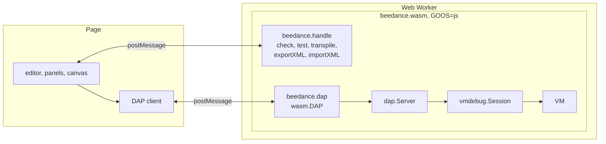

# The web debugger: the engine's side

The beedance debugger runs in a web page: the module built for the web
(`GOOS=js`, `wasm/cmd/beedance-wasm`) serves the same Debug Adapter
Protocol adapter as `beedance -dap`, one message at a time, so a page
debugs a program as VS Code does, with nothing installed. This page is
what the engine gives such a page; [Debugging](debugging.md) is the
protocol, [wasm](../wasm/README.md) the module.

ApiaryTech's browser IDE on it, with a canvas of field devices wired to a
virtual PLC, is **beespace**, a commercial product of its own. Any page
may use the engine as this page describes, under beedance's licences.

## The module in a page

- `globalThis.beedance.dap(onMessage, {yield})` starts a session; `send`
  takes a request, `onMessage` gets each response and event, `close()`
  ends it and frees what it holds. Running the module in a Web Worker
  keeps the page smooth while the VM runs.
- `globalThis.beedance.handle(request)` answers the toolchain's requests:
  `check` (with an outline of the POUs and each PROGRAM's located
  variables, for an editor's search and a canvas's labels), `test`,
  `transpile`, `exportXML` and `importXML` (a project as PLCopen XML,
  with a host's own settings as additional data), and an editor's: `lint`
  (package analyzer), `hover`, `complete`, `definition`, `references`,
  `rename` (package ide) and `diagrams` (each LD, FBD and SFC body drawn
  as SVG, with the names its live view reads).
- **No files in a browser**: `launch` takes the program's text
  (`source`); `beedance/onlineChange` takes the new text.

## The yield

GOOS=js is single-threaded and Go does not preempt there: a program left
running as fast as it goes must give the event loop back between scans,
or no `pause`, write or timer gets in. `vmdebug.Options.YieldEvery` and
`Yield` do it every `wasm.DAPYield` (16 ms). Measured with Go 1.27.2 in
the Web Worker of a page (Playwright 1.64.1), a free-running program:

| Browser | Yield | Scans a second | A request answered after (median, worst) | Paused after |
|---|---|---|---|---|
| Chromium | sleep 1 ms | 304 000 | 18 ms, 86 ms | 158 ms |
| Chromium | MessageChannel | 321 000 | 18 ms, 20 ms | 19 ms |
| Firefox | sleep 1 ms | 278 000 | 1 ms, 52 ms | 1 ms |
| Firefox | MessageChannel | 320 000 | 18 ms, 19 ms | 18 ms |
| WebKit | sleep 1 ms | 309 000 | 18 ms, 71 ms | 3 ms |
| WebKit | MessageChannel | 366 000 | 18 ms, 19 ms | 19 ms |

In a browser, yield by MessageChannel (`{yield: "message"}`): a request
waits at most about one `DAPYield`. Under Node.js keep the default sleep:
Node drains a self-posted port before its timers (a 200 ms timer then
fires after 18 s). `wasm/node/dap.mjs` checks the module under Node.js.

## For a simulator

What a page with virtual field devices needs, in `dap` and `vmdebug`
(see [Debugging](debugging.md) for the messages):

- **The I/O image** (`beedance/io`) and **inputs a scan at a time**
  (`beedance/setInputs`: a press shorter than a scan is still seen; forces
  win over inputs).
- **Scan events** (`beedance/scan`, with `scanEvents` in `launch`): the
  watched values and the I/O image while the program runs, so a page does
  not poll.
- **Plant models**: `PROGRAM PLANT_...` in the source, run after each scan
  on the same clock and I/O image, carried by online change; their
  variables are a scope while stopped.
- **The speed** (`beedance/speed`): simulated time at a multiple of real
  time, or as fast as it goes, changeable while it runs.
- **The trace** (`beedance/trace`): signals recorded at the end of every
  scan, the last scans kept, for a logic analyzer's view.
- **The graphical bodies live** (`beedance/diagrams`): each LD, FBD and SFC
  body of the program debugged, with `ide`'s live view of it (the
  variables shown, each wire's value, an SFC's active steps), a function
  block's body seen through an instance of it. Stopped, as the values are;
  running, as the last scan left them (`vmdebug.Session.SetSampled`).
  The drawing's contract: `data-var` on a contact, coil, pin or step,
  `data-expr` on a wire, `data-vals` and `data-val-expr(s)` on a value's
  text, `data-at="row:col"` an element's place in the source.

## A smaller module

A page that never runs the tests or the transpiler builds the module with
`-tags lite` (see [wasm](../wasm/README.md#build)): about a quarter
smaller, and `version` says which ops it has. The debugger, the analyzer,
package ide and PLCopen are all in it.

## Next on the engine's side

- A `CONFIGURATION`'s tasks (`vmconfig`) under the debugger.
- Editing a graphical body by gestures (`ide.Index.Apply`, as beehive's
  diagram editor does) as an op, for a page's diagram editor.
